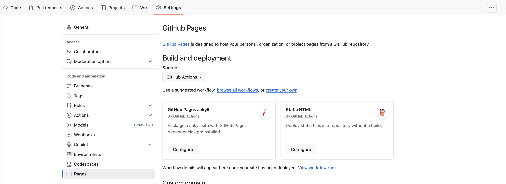
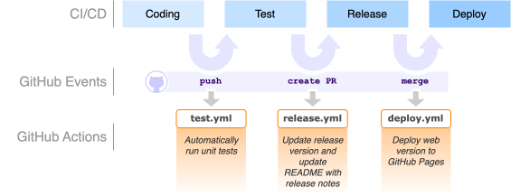

# GitHub Actions Experiments

This repository illustrates how GitHub Actions can be used to automate software development processes.

## Introduction

### What are GitHub Actions?

GitHub Actions are scripts that run on a containerized platform hosted on GitHub. A GitHub action is defined by creating a `.yml` file in the `.github/workflows` directory of a repository (as done here). Such an action needs to follow a specific format as described in the [GitHub documentation](https://docs.github.com/en/actions/about-github-actions/understanding-github-actions). An example is provided in the `triage_issues.yml` action file:

```yaml
name: "Label Issues for Triage"
on:
  issues:
    types:
      - reopened
      - opened
jobs:
  label_issues:
    runs-on: ubuntu-latest
    permissions:
      issues: write
    steps:
      - run: gh issue edit "$NUMBER" --add-label "$LABELS"
        env:
          GH_TOKEN: ${{ secrets.GITHUB_TOKEN }}
          GH_REPO: ${{ github.repository }}
          NUMBER: ${{ github.event.issue.number }}
          LABELS: triage
```

An action consists of the following basic components:

- `name`: name of the action.
- `events`: the `on` keyword specifies under what circumstance the action should run. In this example, the action will run when an issue is opened or reopened.
- `jobs`: specifies one or more things that should happen when the event is triggered. Here, we issue a command to GitHub to edit the modified issue by adding a label.

We will see other types of events and actions later on.

If you are familiar with **containerized applications**, you will notice familiar concepts. One key aspect of a container is to specify its base operating system. Here, we specify that we want to run the latest available version of Ubuntu, which is a Linux operating system. Jobs are similar to `RUN` commands in Docker but are tailored specifically to the task of automating processes and provide many capabilities related to interacting with GitHub.

Now that you understand the basic structure of a GitHub Action, we will see it in, well, action.

### 🚀 Galactic Pizza Delivery Time Estimator

In this exercise, you will work with a small application called the **Galactic Pizza Delivery Time Estimator**. The program calculates how long it takes to deliver a pizza to different planets using several factors: the destination distance, the delivery mode (normal, turbo, or hyperjump), a surge-load multiplier, and a weather-delay component. Some planets involve long-distance fatigue penalties, while incorrect inputs or unexpected weather values trigger errors.

The application can be found in the `spacedelivery` folder. There are two versions:

- `python`: the Python version is a single module (`delivery.py`) and just one function. That module will be used for illustrating **building**, **testing**, and **releasing** applications using GitHub Actions.
- `web` : the web version is a static web application of essentially the same functionality as the Python version. It also implements a user interface. This version is used to illustrate how to **deploy** a static web application to GitHub Pages via GitHub Actions.

The application itself is secondary and only used to illustrate CI/CD concepts.

### Directory structure

The directory structure is as follows:

```bash
github-actions/
├── .github/                          # GitHub-specific configuration
│   └── workflows/                    # This is where GitHub will look for `.yml` Action files. You'll need to create this folder.
├── deployment_scripts/               # Python scripts that will be called by the *release* Action
├── spacedelivery/                    # Main application package
│   ├── delivery.py                   # Python module for delivery calculations
│   └── web/                          # Web version of the application to be deployed by the *deploy* Action
├── tests/                            # Tests that will be executed by the *test* Action
├── __version__.py                    # Version information to be updated by the *release* Action
└── requirements.txt                  # Python dependencies that will be installed during the *build* Action
```

### Getting Started

To get started, fork this repository. You should only make changes in your own copy of the repository. Once you have forked the repository, go to the *Settings* tab of your forked repository and click on *Pages* on the left-hand side. There, click on the *Source* drop-down and select *GitHub Actions*. Note that you need to make the selection even if the value is already pre-populated:



Now, your fork is properly configured. To make changes you'll want to **clone** it to your local machine:

```bash
git clone git@github.com:<your_user_name>/github-actions.git
```

Make sure to replace `<your_user_name>` with your GitHub username. This should create a local folder named `github-actions`.

All modifications are performed in the `development` branch. Therefore, create that branch now by running the following command:

```bash
git checkout -b development
```

All Actions will reside in a folder named `.github/workflows`. Create that folder in the root of your project directory.

👏 You are now all set to start the exercises!

## Exercises

This lab gradually builds up a CI/CD pipeline using GitHub Actions. As you know, Continuous Integration (CI) and Continuous Deployment (CD) are practices that help teams deliver software quickly and reliably. CI focuses on automatically **building** and **testing** code every time changes are made, ensuring that bugs are caught early and that new work integrates smoothly. CD extends this idea by automatically **releasing** and **deploying** software after it passes tests. GitHub Actions provides an easy way to implement CI/CD directly within a GitHub repository. By defining simple workflow files, you can automate tasks such as running tests, checking code quality, updating version numbers, or deploying applications—all triggered whenever code is pushed or a pull request is opened.

The diagram below shows the steps of the CI/CD pipeline that we will build in this lab:



We will implement GitHub Actions that are automatically triggered by events in GitHub, namely:

- `push` event: runs tests whenever a new commit is pushed to the repository
- `pull_request` event: runs tests whenever a new pull request is opened against the repository
- `push` to `main`: triggered whenever a PR is merged into the `main` branch (or code is pushed directly to it) and deploys the application.

These events will trigger GitHub Actions to build, test (`test.yml`), release (`release.yml`), and deploy (`deploy.yml`) the application. You will create these Actions as you follow the exercise instructions.

## Exercise 1: **Testing**

One of the tasks that goes along with making changes to your code is testing. We have learned how to create test cases and even implemented unit tests that can be executed automatically. As part of a CI (Continuous Integration) pipeline, we can run tests automatically whenever a new commit is pushed to the repository. In this exercise, we will integrate that part of the CI pipeline using GitHub Actions.

In the `.github/workflows` directory, create a new file named `test.yml` and copy the following contents:

```yaml
name: Build and test

on:
  push:
    branches: ["development"] # Triggered when a commit is pushed to the development branch

jobs:
  build:
    runs-on: ubuntu-latest # Run this code on a Linux Virtual Machine (VM)

    steps: # Steps that are executed for this Action

      # Checks out the code into the VM
      - name: Checkout repository
        uses: actions/checkout@v4

      # Installs Python
      - name: Set up Python
        uses: actions/setup-python@v5
        with:
          python-version: "3.11"

      # Installs the dependencies
      - name: Install Dependencies
        run: pip install -r requirements.txt

      # Discovers and runs the tests 
      - name: Run tests
        run: pytest -q
```

Save the file and push the changes to the repository:

```bash
git add --all
git commit -m "Added test action"
git push
```

Now, go to your GitHub repository page in your browser and click on the Actions tab. You should see the test action running. Click on the action to reveal details about each step of the action (as defined in the `steps` section of the workflow file).

Is your Action failing? That's ok. That's what we expect. Let's fix it. Check the details of the failed test output. It should tell you what test was failing and where in the code that failure occurred. Go to the respective test in `tests/test_delivery.py` and update the test case to match the value that is returned by the function.

Once you update the test case, push your changes to the repository with the same commands as above. Again, navigate to the Actions tab in GitHub to see the output of the test run.

This exercise illustrates one of the most fundamental parts of a CI/CD pipeline: automated quality assurance by executing test cases. That provides developers early warning signs that something is broken and should be fixed immediately.

## Exercise 2: **Release**

Imagine you have completed making changes to the *Galactic Pizza Delivery Time Estimator* and are ready to push a new release out to your users. There are a variety of steps that could be entailed in a release process. For this exercise, we will have our GitHub Action automatically update the version of our application and create release notes.

ℹ️ [**Semantic versioning**](https://semver.org) is a standardized way of assigning version numbers so that users can understand the scope and impact of changes in a release. A semantic version has the form `MAJOR.MINOR.PATCH` (e.g., `1.8.16`). The `MAJOR` number increases when changes break backward compatibility, `MINOR` increases when new features are added without breaking existing behavior, and `PATCH` increases for backwards-compatible bug fixes.

Keeping up with versions can be tedious, so we will let GitHub Actions handle the versioning for us. Create a new file named `release.yml` in `.github/workflows` and copy the content below:

```yaml
name: Update version and add release notes to README

on:
  pull_request:
    types: [opened] # Only executed when a new PR is created

permissions: # Required for the Action to change our version and README files
  contents: write
  pull-requests: write
  
jobs:

  update_readme:

    runs-on: ubuntu-latest

    steps:

      - name: Checkout repository
        uses: actions/checkout@v4
        with:
          ref: ${{ github.head_ref }}

      - name: Set up Python
        uses: actions/setup-python@v5
        with:
          python-version: "3.x"

      # Calls a Python script to increase the version number in `__version__.py`
      - name: Increase version number
        env:
          PR_TITLE: ${{ github.event.pull_request.title }}
        run: |
          python deployment_scripts/update_version_number.py

      # Calls a Python script to update the release notes in `README.md`
      - name: Update release notes
        env:
          PR_TITLE: ${{ github.event.pull_request.title }}
          PR_BODY: ${{ github.event.pull_request.body }}
        run: |
          python deployment_scripts/update_release_notes.py
 
      # Commits the changes the script made to `__version__.py` and `README.md`
      - name: Commit changes
        run: |
          git config user.name "github-actions[bot]"
          git config user.email "github-actions[bot]@users.noreply.github.com"
          git add __version__.py
          git add README.md
          git commit -m "Add release notes for PR #${{ github.event.pull_request.number }}" || echo "No changes to commit"
          git push
```

The Action itself doesn't do a lot. It just calls Python scripts that reside in our repo (`deployment_scripts`):

- `update_version_number.py`: reads the version number from `__version__.py` and increments it.
- `update_release_notes.py`: reads the PR title and body and adds them to the `README.md` file.

These Python scripts use the information you enter in your PR title and description. To increase the version number, the script checks if the PR title contains `major` or `minor`. If so, it will increase the respective part of the semantic version number. The description of the PR will be used as the release notes that are inserted into the README file.

### Tasks A

Once you have created the `release.yml` Action file, push it to the repository as described above. Now, go to the `Pull request` tab of your GitHub repository. Create a new PR with the following info:

- Title: `Emergency fix for cheese crust pizza`
- Body:

  ```
  - Patching a bug found when calculating cheese crust pizza delivery cost.
  - Slight UI improvements.
  ```

Create the PR and go to the `Actions` tab. You should see the release Action running or already be completed. After the Action is completed, check the `Files changed` section in the PR for the changes made to `__version__.py` and `README.md`.

❓ Can you see what part of the version number was updated (e.g., major, minor, patch)? Do you know why?

We don't really want to merge this PR. Go ahead and click on `Close pull request` at the very bottom of the `Conversation` tab of the PR.

### Tasks B

Now, let's see if we can make our Action update the `Minor` part of the semantic version number. Create a new PR with the following details:

- Title: `Minor update for delivery to Mars`
- Body:
  
  ```bash
  - Can now calculate delivery to Mars!
  - Minor bug fixes
  ```

Create the PR and check again on the Action execution and then the changes it made. Did it work to increase the `minor` part of the version number?

Let's keep this PR open since we'll use it in the next exercise.

This exercise illustrated how we can use GitHub Actions to automate the release process, letting developers focus on being productive and leaving tedious tasks up to the CI/CD pipeline.

## Exercise 3: Deploy

To make our application available to users, we need to deploy it to some server. For this exercise, we will use GitHub Pages to host our application. GitHub Pages is a free hosting service provided by GitHub that allows you to publish static websites directly from a GitHub repository.

Create a file in `.github/workflows` and name it `deploy.yml`. Then copy the contents below:

```yml
name: Deploy static content to Pages

on:
  push:
    branches: [ main ] # Runs when PR is merged to main branch or code is pushed directly to main

  # Allows you to run this workflow manually from the Actions tab
  workflow_dispatch:

# Sets permissions of the GITHUB_TOKEN to allow deployment to GitHub Pages
permissions:
  contents: read
  pages: write
  id-token: write

# Allow only one concurrent deployment, skipping runs queued between the run in-progress and latest queued.
# However, do NOT cancel in-progress runs as we want to allow these production deployments to complete.
concurrency:
  group: "pages"
  cancel-in-progress: false

jobs:

  deploy:
    environment:
      name: github-pages
      url: ${{ steps.deployment.outputs.page_url }}
    runs-on: ubuntu-latest
    steps:

      - name: Checkout
        uses: actions/checkout@v4

      - name: Setup Pages
        uses: actions/configure-pages@v5

      - name: Upload artifact
        uses: actions/upload-pages-artifact@v3
        with:
          path: "./spacedelivery/web" # directory containing the web app files

      - name: Deploy to GitHub Pages
        id: deployment
        uses: actions/deploy-pages@v4
```

Now, push the changes to the `development` branch. Go to the PR that should still be open. If not, you can just create a new PR merging the `development` branch into the `main` branch. Next, click on `Merge pull request`. That event will trigger the deployment script above and deploy the app to GitHub Pages. Go to the page:

<https://enpm611.github.io/github-actions>

but replace the user name to match your forked repository. You should see the app running.

This exercise illustrated the last step of the CI/CD pipeline, which is delivering the application to its final destination from where users will be able to access and interact with it. You have now implemented your own CI/CD pipeline. You can find many more actions in the [GitHub Marketplace](https://github.com/marketplace?type=actions).

## Advanced Exercises

You finished all the exercises above already? Great job! The next few exercises build on the previous ones but introduce some additional complexities. They are ordered by increasing complexity and give you fewer step-by-step instructions as you progress. Consult the [GitHub Actions documentation](https://docs.github.com/en/actions) and the [GitHub Marketplace](https://github.com/marketplace?type=actions) whenever you get stuck. Do all work on the `development` branch unless told otherwise.

## Exercise 4: **Code quality and a test matrix**

So far, our tests only run on `push` to `development`, even though the pipeline diagram promises they also run on pull requests. Real projects also check code style and make sure the code works on more than one runtime version.

### Tasks

1. **Run on pull requests.** Update `test.yml` so that it is also triggered by `pull_request` events targeting `main`. Open a PR from `development` to `main` and verify that the checks appear at the bottom of the PR.
2. **Add a lint step.** Add `flake8` to `requirements.txt` and add a step to `test.yml` that runs `flake8 spacedelivery deployment_scripts tests --max-line-length=100`. Push it and watch it fail. Fix the reported problems in the code (do not simply disable the linter). Hint: some warnings in `tests/test_delivery.py` are intentional (`E402`: import after `sys.path` change). Decide whether to fix the cause or silence only that specific rule for that specific file using a `# noqa: E402` comment.
3. **Add a build matrix.** Use a [`strategy.matrix`](https://docs.github.com/en/actions/using-jobs/using-a-matrix-for-your-jobs) so the tests run on Python `3.10`, `3.11`, and `3.12` in parallel. Replace the hard-coded Python version with `${{ matrix.python-version }}`.
4. **Speed it up.** Enable dependency caching by adding `cache: pip` to the `actions/setup-python` step. Run the workflow twice and compare the duration of the `Install Dependencies` step.

❓ In the Actions tab, how many jobs are shown for a single run now? What happens to the other matrix jobs if one of them fails? Look up the `fail-fast` option and explain when you would want to change it.

## Exercise 5: **Coverage reports and artifacts**

Passing tests say little if they only exercise a fraction of your code. In this exercise, you will measure test coverage, enforce a minimum, and publish the results so that they can be downloaded from a run.

### Tasks

1. Add `pytest-cov` to `requirements.txt`. Change the test step to:

   ```bash
   pytest -q --cov=spacedelivery --cov-report=term-missing --cov-report=xml --cov-report=html --cov-fail-under=90
   ```

2. Push and look at the log output. Which lines (if any) are reported as *missing*? Add test cases to `tests/test_delivery.py` until the build passes. Then raise the threshold to `100` and make sure the pipeline still passes.
3. Use [`actions/upload-artifact`](https://github.com/actions/upload-artifact) to upload the `htmlcov/` directory as an artifact named `coverage-report`. The upload must happen **even when the tests fail** (hint: look at the `if: always()` condition).
4. Write the coverage summary to the run page. GitHub provides a special file, `$GITHUB_STEP_SUMMARY`, that renders Markdown on the workflow summary page. Add a step that appends a short table to this file, for example the percentage reported in `coverage.xml`.
5. Download the artifact from the run summary page, open `index.html` locally, and find the branch/line that is covered by `test_fatigue_penalty_kicks_in`.

❓ Why would you want the coverage upload to run even if tests fail? What is a downside of enforcing 100% coverage as a hard gate?

## Exercise 6: **Smarter releases with labels**

Our release Action decides between `major`, `minor`, and `patch` by searching the PR title for the words "major" or "minor". That is fragile. A PR titled *"Fix minority-language support"* would be treated as a minor release. In this exercise, you will make the release process more robust and discover why that is harder than it looks.

### Tasks

1. **Write failing tests first.** Create `tests/test_deployment_scripts.py` with tests for `bump_version()` in `deployment_scripts/update_version_number.py`. Use pytest's `tmp_path` and `monkeypatch` fixtures to run the function against a temporary `__version__.py` and a fake `PR_TITLE` (hint: the script reads `__version__.py` from the current working directory, so use `monkeypatch.chdir(tmp_path)`; and since `deployment_scripts` is not a package, you may need to add it to `sys.path` or load the module with `importlib`). Cover at least: patch, minor (resets patch to `0`), major (resets minor and patch to `0`), and the *"minority"* false positive described above. The false-positive test should fail. Make sure the new tests are executed by your `test.yml` Action.
2. **Switch to labels.** Create the labels `major` and `minor` in your repository (*Issues → Labels*). Change `release.yml` so that it passes the PR labels to the script, for example:

   ```yaml
   env:
     PR_LABELS: ${{ toJSON(github.event.pull_request.labels.*.name) }}
   ```

   Update `get_release_type()` to read `PR_LABELS` (parse it with `json.loads`) instead of looking at the title. No label means `patch`. If both labels are present, `major` wins.
3. **Discover the timing problem.** Create a PR and add the `minor` label **after** creating it. Was the version bumped correctly? Explain why not, given the `types: [opened]` trigger.
4. **Fix it without bumping twice.** Extend the trigger to include `labeled` and `unlabeled` (and optionally `synchronize`). Now every label change causes a second bump on top of the first one. Design and implement a solution such that the version in the PR is always *exactly one bump* ahead of the version on `main`, no matter how many times the workflow runs. Hint: compare against the version on the base branch, e.g. by checking out `${{ github.base_ref }}` or running `git show origin/${{ github.base_ref }}:__version__.py`.
5. **Do not duplicate release notes.** The script `update_release_notes.py` appends to the end of the README every time it runs. Make it replace the entry for the current PR instead of adding another one (hint: add a hidden marker such as `<!-- release-notes:PR-123 -->` to each entry).
6. **Avoid infinite loops.** Your Action pushes a commit to the PR branch. Explain why this does not trigger the test workflow when you use the default `GITHUB_TOKEN`, and what would change if you used a personal access token instead.

❓ Why is passing `github.event.pull_request.title` through `env:` safer than writing `${{ github.event.pull_request.title }}` directly inside a `run:` script? Look up *script injection* in the [GitHub security hardening guide](https://docs.github.com/en/actions/security-for-github-actions/security-guides/security-hardening-for-github-actions).

## Exercise 7: **Pipeline orchestration and reusable workflows**

Right now `test.yml` and `deploy.yml` are completely independent. Pushing a broken change to `main` still deploys it to production. In this exercise, you will connect the pieces so that deployment can only happen after the tests pass, without copy-pasting steps.

### Tasks

1. **Make `test.yml` reusable.** Add a `workflow_call` trigger to `test.yml` in addition to the existing triggers:

   ```yaml
   on:
     push:
       branches: ["development"]
     pull_request:
       branches: ["main"]
     workflow_call:
   ```

2. **Gate the deployment.** In `deploy.yml`, add a first job named `test` that calls the reusable workflow with `uses: ./.github/workflows/test.yml`. Then make the existing `deploy` job depend on it using `needs: test`.
3. **Prove the gate works.** On `development`, deliberately break a test (e.g., change an expected value), open a PR to `main`, and merge it. Verify that the `deploy` job is *skipped* and the live site is unchanged. Then fix the test, push again, and watch the deployment succeed. (Remember to repair `main` before continuing!)
4. **Add a smoke test after deployment.** Add a third job, `verify`, that runs after `deploy` (`needs: deploy`) and uses `curl --fail --retry 5 --retry-delay 5` against the deployed URL. Pass the URL between jobs using the `outputs` of the `deploy` job (hint: `${{ steps.deployment.outputs.page_url }}`). Check that the HTML contains the title of the application using `grep`.
5. **Add a manual trigger with an input.** Give `deploy.yml` a `workflow_dispatch` input named `skip_tests` (type `boolean`, default `false`). When it is `true`, the `test` job should be skipped but `deploy` must still run. This is trickier than it sounds because a job that `needs` a skipped job is also skipped by default. Look up the `if:` expressions `always()` and `needs.<job>.result`.

❓ Draw the dependency graph (`test → deploy → verify`) of your workflow. Compare it to the visualization that GitHub shows on the run summary page.

## Exercise 8: **Hardening the pipeline**

Workflows run code with access to your repository and tokens, which makes them an attractive attack target. In this exercise, you will review your own pipeline as a security engineer would.

### Tasks

1. **Least privilege.** Set `permissions: {}` (no permissions) at the top of `test.yml`, then grant back only what each job needs. Does the test job still work? Why does `actions/checkout` need `contents: read` when the repository is private but not necessarily when it is public?
2. **Pin actions to commit SHAs.** Tags like `@v4` can be moved by the action's owner. Replace every `uses:` reference in your workflows with the full commit SHA of the release, keeping the version as a comment:

   ```yaml
   uses: actions/checkout@<full-40-character-sha> # v4.2.2
   ```

3. **Keep them up to date automatically.** Pinned SHAs are painful to update by hand. Create `.github/dependabot.yml` with entries for the `github-actions` and `pip` ecosystems, checked weekly. Explain in your own words why Dependabot PRs are a good fit for the pipeline you built in Exercises 4-7.
4. **Restrict who can trigger a deployment.** In your fork under *Settings → Environments → github-pages*, add a *Required reviewer* (yourself) and restrict deployments to the `main` branch. Trigger a deployment and approve it from the run page.
5. **Find the vulnerability.** The following step is added to a workflow in your repository by a (well-meaning) teammate:

   ```yaml
   - name: Greet contributor
     run: echo "Thanks for the PR '${{ github.event.pull_request.title }}'!"
   ```

   Craft a PR title that makes this step execute an additional command (try printing the string `pwned` on a separate line - **only in your own fork**). Then fix the step using an environment variable, as in `release.yml`.
6. **Write a short threat model** (5-10 sentences) in a new file `docs/pipeline_security.md`: Which secrets and permissions does your pipeline have? What could an attacker do who can open a PR from a fork? What mitigations have you applied?

## Exercise 9 (Capstone): **Tag-based releases and a custom composite action**

In this final exercise, you will bring everything together by building a release process that publishes a downloadable package whenever a version tag is pushed, and by extracting duplicated steps into a custom action.

### Tasks

1. **Create a composite action.** Several of your workflows now repeat the same steps: checkout, set up Python, install dependencies. Create `.github/actions/setup-python-env/action.yml` as a [composite action](https://docs.github.com/en/actions/sharing-automations/creating-actions/creating-a-composite-action) with an input `python-version` (default `3.11`). Replace the duplicated steps in `test.yml` and `release.yml` with `uses: ./.github/actions/setup-python-env`.
2. **Build a distributable.** Add a small `pyproject.toml` (or `setup.cfg`) so that `spacedelivery` can be built as a package, with the version read dynamically from `__version__.py`. Verify locally with `pip install build && python -m build`.
3. **Create `publish.yml`.** The workflow must be triggered when a tag matching `v*.*.*` is pushed. It should have three jobs:
   - `test`: reuses `test.yml` (Exercise 7).
   - `build`: builds the package with `python -m build` and uploads `dist/` as an artifact.
   - `release`: downloads the artifact and creates a GitHub Release using `gh release create "$GITHUB_REF_NAME" dist/* --generate-notes`. This job needs `permissions: contents: write`.
4. **Validate the tag.** Add a step to the `build` job that fails if the pushed tag (`v1.2.3`) does not match the version in `__version__.py` (`1.2.3`). Test both the success and failure cases by pushing a matching and a non-matching tag.
5. **Schedule a nightly check.** Add a `schedule` trigger (cron) to `test.yml` that runs the tests every night at 03:00 UTC, so that you notice if a dependency update breaks the build even when nobody pushes code. Use `workflow_dispatch` to trigger it manually while testing. What are the limitations of scheduled workflows on forks and inactive repositories?
6. **Stretch goals** (pick one):
   - Publish the package to [TestPyPI](https://test.pypi.org) using [trusted publishing (OIDC)](https://docs.pypi.org/trusted-publishers/) instead of a stored API token.
   - Build and push a Docker image of the application to the GitHub Container Registry (`ghcr.io`) with `docker/build-push-action`.
   - Post a comment on each PR with the coverage summary from Exercise 5 using `actions/github-script`.

❓ Look at your finished pipeline. Which events trigger which workflows? Create a table or diagram that documents it, and update `docs/github_actions_exercises.svg` or add a Mermaid diagram to this README.

# Release notes

This section should be populated by the *release* Action.
